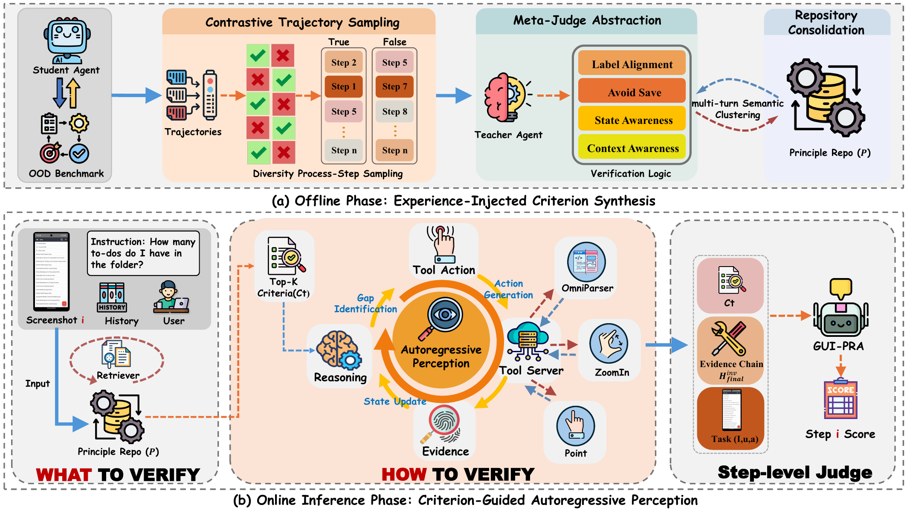

<h1 align="center">GUI-PRA (EMNLP2026)</h1>

<p align="center">
  
  
  
</p>

GUI-PRA 是面向 GUI 任务的过程奖励智能体。方法在离线阶段从对比轨迹中提炼验证准则，在在线阶段检索相关准则、识别信息缺口、调用视觉工具获取证据，并对每个动作步骤进行判断。

本目录包含方法说明，以及 GUI-PRA 使用的可复现实验工具。相同的 HTTP 接口也可以接入其他智能体、评测器或开发环境。

## 📌 待开源内容

- [x] Tool 开源
- [ ] Benchmark 测试开源

这两个部分保持独立，视觉工具可以在不依赖 benchmark 数据和评测后端的情况下接入其他环境。

## 🧠 方法概览

离线阶段包括对比轨迹采样、由 Meta-Judge 抽象验证逻辑，以及将准则合并到原则仓库。在线推理阶段，智能体检索相关准则，识别当前信息缺口，在需要时调用视觉工具，更新状态并生成证据链，最后由 step-level judge 对动作步骤进行评分。

<p align="center">
  
</p>

<p align="center"><a href="assets/method/method_20260824.pdf">下载方法总览图 PDF</a></p>

## 🌟 主要能力

- **Controller + worker**：每个工具独立进程、端口、GPU、模型和日志，统一通过 Controller 发现。
- **Point**：使用 Molmo 根据自然语言描述定位屏幕中的点，并返回标注图。
- **omni_parser**：使用 OCR、图标检测和 caption 生成全局 UI 元素清单。
- **ZoomInSubfigure**：调用 OpenAI 兼容的视觉模型定位目标区域，转换 0–999 坐标并返回带上下文的裁剪图。
- **独立生命周期**：启动前检查模型路径和端口，按 run-id 保存日志，停止时只清理本次启动的进程。
- **简单 HTTP 协议**：Controller 提供发现接口，worker 提供统一的 `POST /worker_generate`。

## 🧩 系统结构

```text
Client（GUI-PRA / 评测 / 自定义应用）
                    │
                    ▼
Controller :20001  ──► Point :20027             ──► Molmo
                    ├──► omni_parser :20030     ──► YOLO + OCR + Florence-2
                    └──► ZoomInSubfigure :20039 ──► Qwen3-VL API :8008
```

Controller 只负责发现和 shortest-queue 调度，不加载视觉模型。Point 和 OmniParser 是本地 GPU worker；OmniParser 内的 OCR 使用 CPU。ZoomInSubfigure 是无状态本地 worker，视觉区域定位通过单独的 HTTP API 完成。

## ⚙️ 安装

### 1️⃣ 创建 UI-Tool 环境

从本目录根目录执行：

```bash
conda env create -f environments/ui-tool.yml
conda activate gui-pra-ui-tool
python -m pip install -r environments/requirements-ui-tool.txt
python -m pip check
```

因为 Molmo/Florence 与 critic 评测使用不同的 Transformers 版本，所以工具环境和 benchmark 环境分开。安装后检查 CUDA：

```bash
python -c 'import torch; print(torch.__version__, torch.version.cuda, torch.cuda.is_available())'
```

### 2️⃣ 准备模型

复制配置模板并修改路径：

```bash
cp configs/local.env.example configs/local.env
# 编辑 configs/local.env
source configs/local.env
```

| Worker | 模型资源 | 配置变量 |
| --- | --- | --- |
| Point | [allenai/Molmo-7B-D-0924](https://huggingface.co/allenai/Molmo-7B-D-0924) | `MOLMO_MODEL_PATH` |
| OmniParser 检测 | [microsoft/OmniParser-v2.0](https://huggingface.co/microsoft/OmniParser-v2.0) 的 `icon_detect/model.pt` | `OMNIPARSER_DETECT_PATH` |
| OmniParser caption | 完整的 Florence-2 + OmniParser caption bundle | `OMNIPARSER_CAPTION_PATH` |
| ZoomInSubfigure | OpenAI 兼容的 Qwen3-VL API | `ZOOM_API_URL`、`ZOOM_MODEL_NAME` |

如果手上只有 Florence 基础模型目录和 OmniParser caption 权重，可以在新的目录生成 bundle，不会修改来源文件：

```bash
python scripts/prepare_caption_bundle.py \
  --florence-base models/Florence-2-base \
  --icon-caption models/OmniParser-v2.0/icon_caption \
  --output models/OmniParser-caption-bundle
```

模型权重不随源码包提供，请以各模型卡片中的下载、许可证和使用条件为准。

### 3️⃣ 准备外部视觉 API

工具框架要求 Zoom API；GUI-PRA 额外需要原则选择、工具路由和 observation 过滤 API。可用独立 vLLM 环境启动示例：

```bash
conda env create -f environments/vllm.yml
conda activate gui-pra-vllm
python -m pip install -r environments/requirements-vllm.txt

VLM_MODEL_PATH=/path/to/Qwen3-VL-8B-Instruct \
VLM_MODEL_NAME=qwen3-vl-8b-instruct VLM_GPUS=3 VLM_PORT=6008 \
  bash scripts/serve_vlm.sh

VLM_MODEL_PATH=/path/to/Qwen3-VL-32B-Instruct \
VLM_MODEL_NAME=qwen3-vl-32b-instruct VLM_GPUS=4,5 VLM_TP=2 VLM_PORT=8008 \
  bash scripts/serve_vlm.sh
```

需要根据实际 GPU、显存和 vLLM 版本检查参数；`ZOOM_MODEL_NAME` 必须和 API 的 `--served-model-name` 一致。

## 🚀 运行 GUI-PRA

原始启动形式可以直接在新目录根目录执行：

```bash
conda activate gui-pra-ui-tool
source configs/local.env
export PYTHONPATH=$PWD:$PYTHONPATH
python UI_Tool/launch_scripts/start_server_local.py \
  --config UI_Tool/launch_scripts/config/all_service_example_local_1.yaml
```

推荐先预览解析后的命令：

```bash
python UI_Tool/launch_scripts/start_server_local.py \
  --config UI_Tool/launch_scripts/config/all_service_example_local_1.yaml --dry-run
```

默认端口为 Controller `20001`、Point `20027`、OmniParser `20030`、Zoom `20039`，默认 GPU 为 Point=0、OmniParser=1。端口和 GPU 都在配置中可修改，必须确保没有和现有服务冲突。每次启动的日志和运行信息进入 `runtime/ui-tool/<run-id>/`。在启动终端按 `Ctrl+C` 只停止本次启动的服务。

## 🧪 健康检查与 smoke test

在另一个终端执行：

```bash
conda activate gui-pra-ui-tool
source configs/local.env
python scripts/check_services.py
python scripts/check_services.py --smoke
```

不带 `--smoke` 时检查 Controller、三个 worker 的注册状态和配置的 VLM 模型名；带 `--smoke` 时使用包内的 `assets/smoke_ui.png` 实际调用三个工具，结果写入 `runtime/tool-smoke/`。HTTP 成功只表示服务链路可用，还需要检查返回的文字和图片质量。

## 📡 HTTP 接口

发现 worker：

```bash
curl -sS -X POST http://127.0.0.1:20001/list_models
curl -sS -X POST http://127.0.0.1:20001/get_worker_address \
  -H 'Content-Type: application/json' \
  -d '{"model":"Point"}'
```

三个注册名称是 `Point`、`omni_parser` 和 `ZoomInSubfigure`。YAML/日志中使用的 `OmniParser` 只是人类可读标签。

直接调用 worker：

```python
import base64
import requests

image = base64.b64encode(open("assets/smoke_ui.png", "rb").read()).decode()
controller = "http://127.0.0.1:20001"
worker = requests.post(
    controller + "/get_worker_address", json={"model": "Point"}, timeout=10
).json()["address"]
response = requests.post(
    worker + "/worker_generate",
    json={"image": image, "param": "The blue Save button"},
    timeout=120,
)
response.raise_for_status()
print(response.json()["text"])
```

成功响应包含 `error_code: 0`、`text`，并可能包含 base64 编码的 `edited_image`。Point 坐标对应输入截图坐标系；ZoomInSubfigure 的模型输出采用 0–999 归一化坐标，worker 负责转换到图片像素并添加上下文边界。

## 🧰 配置说明

主配置是 [`UI_Tool/launch_scripts/config/all_service_example_local_1.yaml`](UI_Tool/launch_scripts/config/all_service_example_local_1.yaml)，支持 `${NAME}` 和 `${NAME:-default}`：

```yaml
base_dir: "${PROJECT_ROOT}/UI_Tool"
runtime_dir: "${UI_TOOL_RUNTIME_DIR:-runtime/ui-tool}"
controller_config:
  cmd:
    port: "${UI_TOOL_CONTROLLER_PORT:-20001}"
tool_worker_config:
  - Point:
      cuda_visible_devices: "${POINT_GPU:-0}"
      cmd:
        model_path: "${MOLMO_MODEL_PATH:-/path/to/Molmo-7B-D-0924}"
```

关键变量：

- `POINT_GPU`、`OMNIPARSER_GPU`：本地 GPU worker 使用的设备编号。
- `MOLMO_MODEL_PATH`、`OMNIPARSER_DETECT_PATH`、`OMNIPARSER_CAPTION_PATH`：模型目录或权重文件。
- `ZOOM_API_URL`、`ZOOM_MODEL_NAME`：Zoom API 地址和模型名。
- `UI_TOOL_CONTROLLER_PORT`、`POINT_PORT`、`OMNIPARSER_PORT`、`ZOOM_PORT`：互不重复的服务端口。
- `UI_TOOL_RUNTIME_DIR`、`UI_TOOL_HF_HOME`：运行日志和模型缓存目录。

如果跨主机部署，需要开放 Controller 和 worker 端口，设置 `UI_TOOL_HOST=0.0.0.0`，并把 `GUIPRA_TOOL_CONTROLLER_ADDR` 指向 Controller 主机。HTTP 接口没有内置应用层认证，建议只在可信网络或带认证的反向代理后使用。

## 🧱 开发检查

完整源码目录提供离线回归测试，使用真实 Controller 和测试 fake worker，不加载模型，也不请求外部 API。工具专用源码包可以使用 launcher 的 `--dry-run` 和 `scripts/check_services.py --help`。在完整源码目录中运行依赖评测代码的回归测试：

```bash
conda activate gui-pra-benchmark
python -m pip install -r environments/requirements-test.txt
PYTHONDONTWRITEBYTECODE=1 python -m unittest discover -s tests -v
```

## 🔌 接入其他开发环境

视觉 worker 提供简洁的 HTTP 协议，可以接入已有的智能体或评测系统。启动服务后，通过 `/get_worker_address` 获取 worker 地址，再向 `/worker_generate` 发送 base64 编码的截图。请确保运行应用的主机能够访问 Controller 和 worker 端口，并将返回的 `text` 与 `edited_image` 字段接入自己的 observation 流程。这里的配置和脚本是可替换模板，可以更换模型 endpoint、进程管理方式或客户端，同时保持请求格式不变。

## 📜 引用

如果使用 GUI-PRA，请引用：

```bibtex
@misc{xiong2026guipraprocessrewardagent,
      title={GUI-PRA: Process Reward Agent for GUI Tasks},
      author={Tao Xiong and Xavier Hu and Yurun Chen and Yuhang Liu and Changqiao Wu and Pengzhi Gao and Wei Liu and Jian Luan and Shengyu Zhang},
      year={2026},
      eprint={2509.23263},
      archivePrefix={arXiv},
      primaryClass={cs.AI},
      url={https://arxiv.org/abs/2509.23263},
}
```

同时请引用 [`THIRD_PARTY_NOTICES.md`](THIRD_PARTY_NOTICES.md) 中列出的上游模型和工具项目。

## 📮 联系方式

Feel free to contact us: xiongtao@zju.edu.cn
